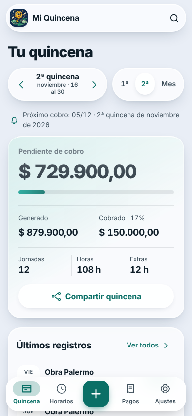
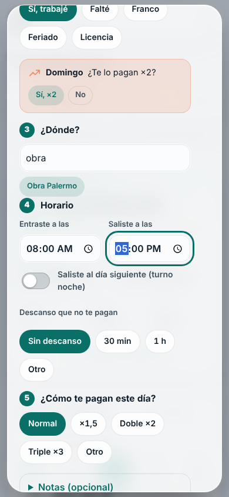
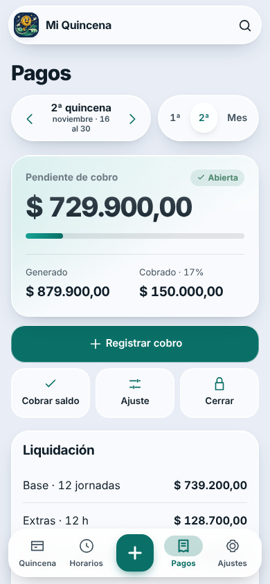
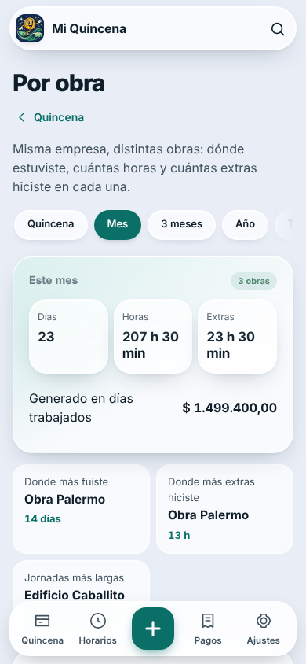
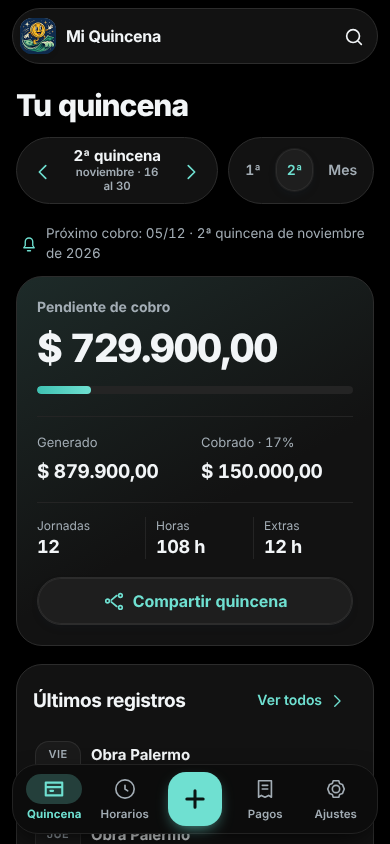
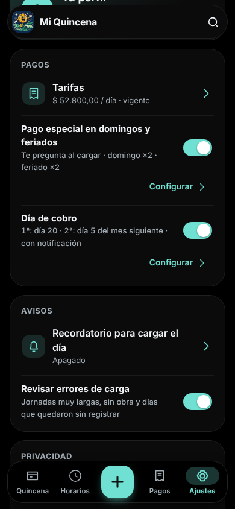

<div align="center">


# Mi Quincena

**Tus horarios y lo que te pagan, quincena por quincena.**
Registrás cada día que trabajás y la app calcula sola cuánto generaste, cuánto cobraste y cuánto te deben.

[](https://github.com/kkshiiit/Mi-Quincena/releases/latest)
[](https://github.com/kkshiiit/Mi-Quincena/actions)







</div>

---

## ✨ Qué hace

| | |
|---|---|
| 🗓️ **Registrar el día en pasos** | Hoy/Ayer, ¿trabajaste?, obra (con sugerencias), entrada y salida, descanso en un toque. El turno noche se detecta solo. |
| 💰 **Pago del día** | Normal, ×1,5, doble, triple u otro. Opcional: en domingos y feriados te **pregunta** si te lo pagan distinto (nunca lo aplica solo). |
| 📊 **Quincena** | Pendiente de cobro, generado, cobrado con %, horas y extras. Avisos de día de cobro y de días sin registrar. |
| 🧾 **Pagos** | Registrás cada cobro eligiendo la quincena (ves cuánto te deben de cada una), ajustes (viáticos, adelantos) y cierre de quincena. |
| 🏗️ **Por obra** | Misma empresa, distintas obras: días, horas y extras en cada una; dónde más fuiste y dónde más extras hiciste. |
| 📈 **Tarifas por vigencia** | Por día, hora o mes. Aumentos por % o importe desde una fecha; los días anteriores conservan su valor. Hora extra fija o con recargo %. |
| 📤 **Compartir** | WhatsApp, imagen, PDF con firmas, Excel con fórmulas y Word. |
| 🔒 **Privacidad** | Sin permiso de internet, sin cuenta ni publicidad. Bloqueo con PIN o huella (con espera tras 5 errores) y ocultar en apps recientes. |
| 💾 **Tus datos** | Copias completas, versiones automáticas, Google Drive, importar Excel. Restaurar combinando o reemplazando, sin pisar tu tema. |
| 🎨 **A tu gusto** | Claro, oscuro, AMOLED, 8 colores de acento, sin animaciones. |

Cada función opcional se prende y se apaga desde **Ajustes → Funciones**.

<div align="center">


</div>

## 📲 Instalar

1. Entrá a **[Releases](https://github.com/kkshiiit/Mi-Quincena/releases/latest)** y descargá `Mi-Quincena.apk`.
2. Abrilo en tu Android (8.0 o más nuevo) y aceptá instalar desde esa fuente.

> [!IMPORTANT]
> **¿Ya tenés la app?** Antes de actualizar, exportá una copia: *Ajustes → Tus datos → Copias de seguridad → Exportar*. Si Android pide desinstalar (pasa cuando el APK está firmado con otra clave), desinstalá, instalá y restaurá la copia.

📖 Guía completa con ejemplos: **[docs/GUIA.md](docs/GUIA.md)** (también está dentro de la app).

## 🧮 Cómo calcula

```
Horas      = salida − entrada − descanso   (+24 h si sale al día siguiente)
Extras     = horas − jornada normal        (o fuera de un horario fijo)
Valor hora = día ÷ jornada  ·  hora  ·  mes ÷ (25 × jornada)
Día        = (base + extras × valor extra) × pago del día
Pendiente  = Σ días + sueldo mensual + ajustes − cobrado
```

Todo al centavo, con la tarifa vigente en cada fecha. Verificado con tests y una prueba de 3000 escenarios al azar.

## 🛠️ Para desarrollar

```
app/        Interfaz y lógica (HTML, CSS y JavaScript puro, sin frameworks)
  core.js        Cálculos puros y testeados
  app.js         Pantallas, formularios, exportaciones
  style.css      Diseño y temas
  logo.js        Ícono embebido
android/    Contenedor nativo (proyecto apktool: manifiesto, recursos, smali)
tests/      Tests de cálculo y prueba de 3000 escenarios
scripts/    build.sh: arma y firma el APK
docs/       Guía, arquitectura, privacidad, capturas
```

```bash
npm test                 # cálculos, 3000 escenarios y versión
npm run test:ui          # prueba de interfaz (necesita playwright)
npm run serve            # probar la interfaz en http://localhost:8765
APKTOOL_JAR=… SIGNER_JAR=… npm run build   # APK en dist/
```

Cada push corre los tests y compila un APK de prueba (Actions → artefacto). Al llegar a `main` una versión nueva (`package.json`), se publica sola el Release con el APK.

**Firma:** sin clave se firma con una clave de prueba. Para que las actualizaciones se instalen encima, cargá en *Settings → Secrets → Actions*: `MQ_KEYSTORE_B64` (tu `.jks` en base64), `MQ_KEY_ALIAS` y `MQ_KEY_PASS`. Nunca subas la clave al repositorio.

Más detalle: [Arquitectura](docs/ARQUITECTURA.md) · [Privacidad](docs/PRIVACIDAD.md) · [Auditoría](docs/AUDITORIA.md) · [Cambios](CHANGELOG.md)

## 🙌 Créditos

- [SheetJS](https://sheetjs.com) 0.20.3 (Apache 2.0): Excel, importación y empaquetado de Word.
- [jsPDF](https://github.com/parallax/jsPDF) 4.2.1 (MIT): PDF.
